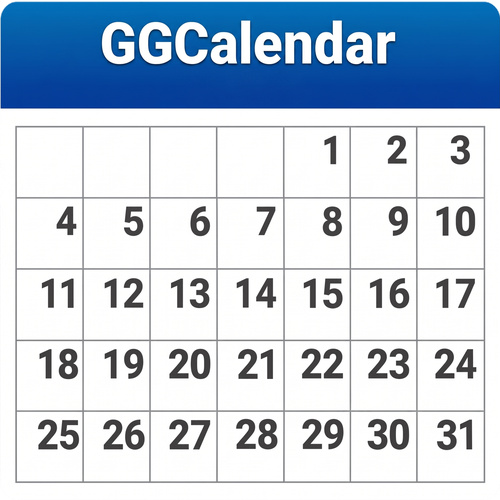

<p align="center"></p>

<p align="center"><a href="https://github.com/giansalvo/GGCalendar/actions/workflows/ci.yml"></a></p>

<h1 align="center">GGCalendar</h1>

<p align="center">Calendario para Windows 11 con sincronización con Google Calendar.</p>

<p align="center">
  <a href="https://github.com/giansalvo/GGCalendar/releases/latest">Descargar la última versión</a> ·
  <a href="https://profgusinu.altervista.org/GGCalendar/es/index.html">Sitio web</a> ·
  <a href="https://profgusinu.altervista.org/GGCalendar/es/privacy.html">Privacidad</a> ·
  <a href="https://profgusinu.altervista.org/GGCalendar/es/terms.html">Términos</a> ·
  <a href="LICENSE">Licencia GPL v3 o posterior</a>
</p>

<p align="center">🌐 <a href="README.md">Italiano</a> · <a href="README.en.md">English</a> · <a href="README.de.md">Deutsch</a> · Español · <a href="README.fr.md">Français</a></p>

---

## Funciones

- Vistas de día, semana, 6 días, mes, año y programa; los fines de semana se pueden ocultar
- Crear, mover y redimensionar eventos arrastrando, también entre calendarios distintos
- Ficha resumen al hacer clic en un evento (editar, eliminar, escribir a los invitados, exportar, unirse a Meet); doble clic para editarlo
- Eventos recurrentes, con edición o eliminación de una sola repetición, de las siguientes o de toda la serie
- Recordatorios con notificación, alarma sonora (hasta que la apagas, como máximo 2 minutos) y posposición, conservados también tras un reinicio
- Sincronización en ambos sentidos con una o más cuentas de Google Calendar, con gestión de conflictos; las alarmas viajan con el evento en Google y se comparten con [GGCalendar Mobile](https://github.com/giansalvo/GGCalendarMobile) para Android
- Invitados, enlaces de Google Meet, recordatorios por correo (enviados por Google)
- Búsqueda de un texto en título, descripción, lugar e invitados, en uno o varios calendarios, con fechas y palabras a excluir
- Calendarios locales, importación y exportación de archivos `.ics`
- Tema claro y oscuro
- Interfaz en italiano, inglés, alemán, español y francés: el idioma se elige en *Ajustes* (por defecto, el de Windows) y cambia al instante

## Instalación

Descarga `GGCalendar-v<versión>-Setup.exe` desde la página de [Releases](https://github.com/giansalvo/GGCalendar/releases/latest) y ejecútalo. El instalador habla el idioma de Windows si es uno de los cinco anteriores (inglés en caso contrario).

- Requisitos: Windows 11 de 64 bits. El runtime de .NET está incluido, no hacen falta otros componentes.
- Por defecto se instala solo para el usuario actual, sin permisos de administrador.
- El instalador no está firmado digitalmente: si Windows SmartScreen muestra «Windows protegió su PC», elige **Más información → Ejecutar de todas formas**.

Los datos de la app están en `%AppData%\GGCalendar` y la desinstalación no los borra.

## Compilar desde el código fuente

Requisitos: [.NET SDK 10](https://dotnet.microsoft.com/download) en Windows.

```powershell
git clone https://github.com/giansalvo/GGCalendar.git
cd GGCalendar
dotnet run --project src/GGCalendar.App
dotnet test
```

### Credenciales de Google

Las credenciales OAuth de la app oficial no están en el repositorio. Para usar la sincronización con una compilación hecha por ti necesitas tu propio proyecto de Google Cloud:

1. En la [Google Cloud Console](https://console.cloud.google.com/) habilita la **Google Calendar API**.
2. Configura la pantalla de consentimiento de OAuth con el ámbito `https://www.googleapis.com/auth/calendar`.
3. Crea un ID de cliente de OAuth de tipo **Aplicación de escritorio** y descarga el archivo JSON.
4. Copia el archivo en una carpeta `OAuth/` en la raíz del repositorio, con un nombre que empiece por `client_secret` (la carpeta está excluida de git): se incluirá en el ejecutable al compilar.

Como alternativa puedes introducir el ID de cliente y el secreto en la app, en *Ajustes → Cuentas de Google → Avanzado*.

### Crear el instalador

Requiere [Inno Setup 6](https://jrsoftware.org/isinfo.php) (`winget install JRSoftware.InnoSetup`) y las credenciales de Google descritas arriba.

```powershell
.\installer\build-installer.ps1
```

El script publica la app autocontenida para `win-x64` y crea `website/downloads/GGCalendar-v<versión>-Setup.exe`, tomando la versión de `InformationalVersion` en `src/GGCalendar.App/GGCalendar.App.csproj`.

## Estructura del proyecto

| Carpeta | Contenido |
|---|---|
| `src/GGCalendar.Core` | Modelos, repeticiones (RRULE), parser y writer de ICS, cálculo de recordatorios, disposición de eventos superpuestos, textos en los cinco idiomas (`Localization`) |
| `src/GGCalendar.Data` | Almacén SQLite de calendarios y eventos, cola de cambios por enviar, ajustes, estado de los recordatorios |
| `src/GGCalendar.Providers.Google` | Acceso OAuth (PKCE, redirección en loopback) y cliente de las API de Google Calendar |
| `src/GGCalendar.App` | Interfaz [Avalonia](https://avaloniaui.net/) (MVVM), sincronización, notificaciones y sonidos |
| `tests/GGCalendar.Core.Tests` | Pruebas xUnit |
| `installer` | Script de Inno Setup y script de compilación del instalador |
| `website` | Sitio de presentación, política de privacidad y términos, en cinco idiomas |

## Privacidad

GGCalendar no tiene servidores propios y no recoge telemetría. Tus datos permanecen en tu ordenador y, si conectas una cuenta de Google, viajan solo entre el ordenador y Google. Los detalles están en la [política de privacidad](https://profgusinu.altervista.org/GGCalendar/es/privacy.html); las condiciones de uso, en los [términos de servicio](https://profgusinu.altervista.org/GGCalendar/es/terms.html). Los textos italianos son los de referencia.

## Licencia

Copyright © 2026 Giansalvo Gusinu.

GGCalendar es software libre: puedes redistribuirlo y/o modificarlo según los términos de la GNU General Public License publicada por la Free Software Foundation, ya sea la versión 3 de la licencia o (a tu elección) cualquier versión posterior. Se distribuye con la esperanza de que sea útil, pero **sin ninguna garantía**, ni siquiera la garantía implícita de comerciabilidad o de idoneidad para un fin particular. El texto completo está en el archivo [LICENSE](LICENSE).

### Términos adicionales (GPL v3, sección 7)

El nombre «GGCalendar» y el logotipo (archivos `img/GGCalendar.jpg`, `img/GGCalendar_logo.jpg`, `src/GGCalendar.App/Assets/GGCalendar.ico`, `src/GGCalendar.App/Assets/GGCalendar_logo.jpg`, `website/assets/logo.jpg`) identifican la app original del autor:

- conforme a la sección 7(e), la licencia no concede ningún derecho de uso del nombre y del logotipo como marcas;
- conforme a la sección 7(c), quien distribuya una versión modificada debe usar un nombre y un logotipo distintos, para que no se confunda con el original. Se permite declarar que deriva de GGCalendar.
